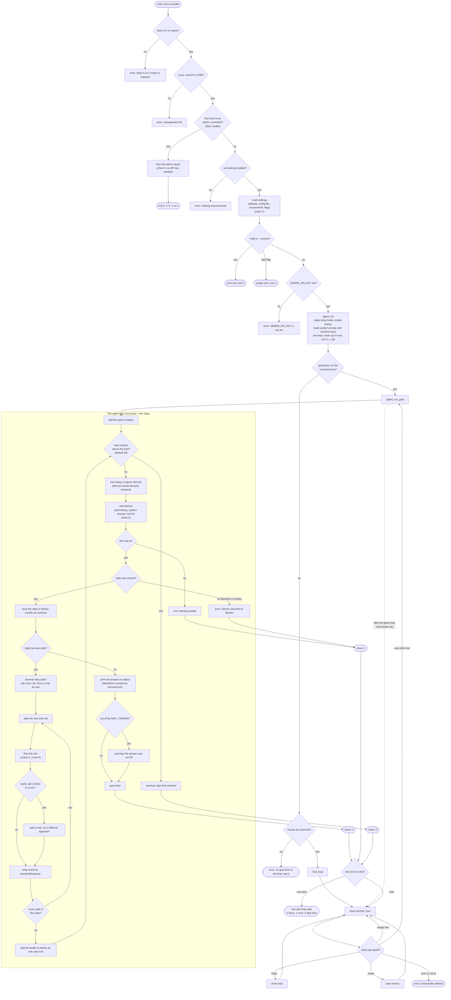
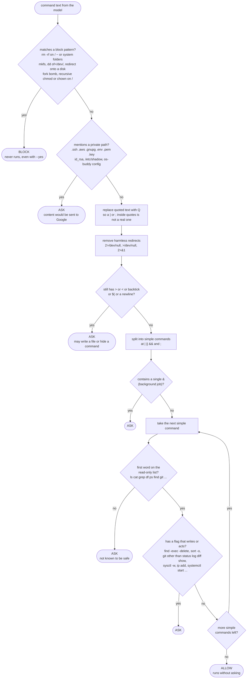
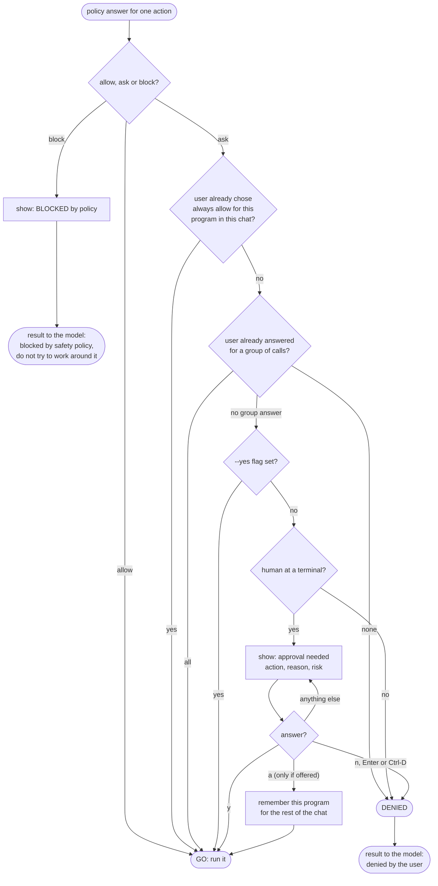
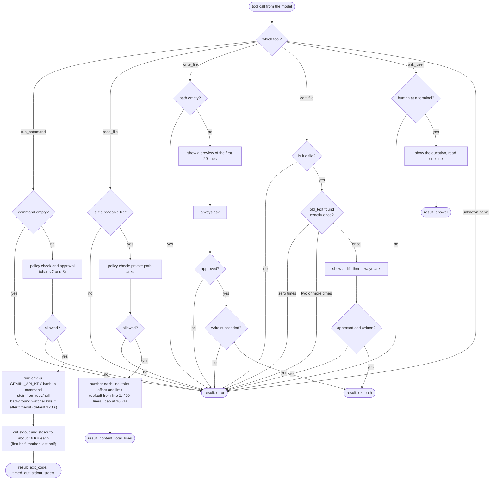
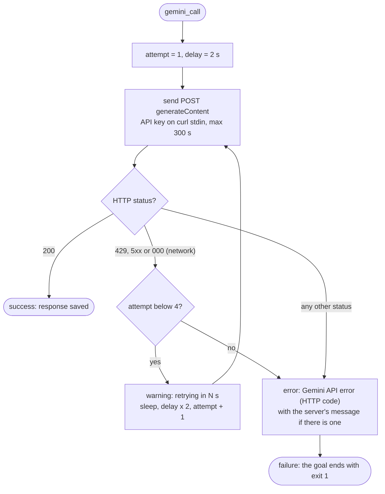
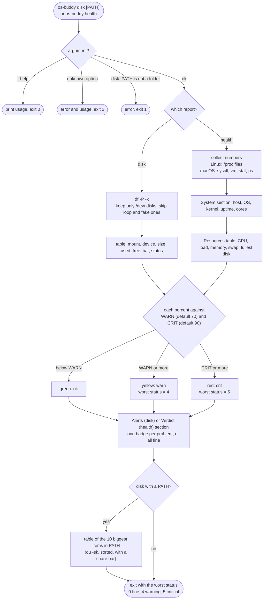
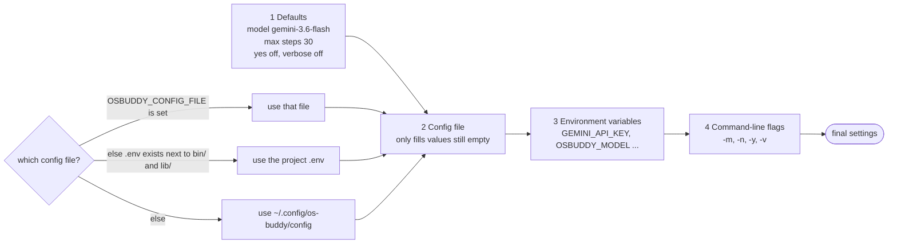

# os-buddy flow charts

These flow charts show **every decision and branch** in os-buddy, from start to end.
They match the code in `bin/os-buddy` and `lib/*.sh`.

Related docs: [sequence-diagram.md](sequence-diagram.md) (who talks to whom), [use-case-diagram.md](use-case-diagram.md) (who can do what), [design.md](design.md) (PEAS design).

| # | Chart | Code |
|---|---|---|
| 1 | [The whole program, start to end](#1-the-whole-program-start-to-end) | `bin/os-buddy`, `lib/agent.sh` |
| 2 | [How a command is classified](#2-how-a-command-is-classified-allow-ask-or-block) | `policy_check_command` |
| 3 | [How an action gets approved](#3-how-an-action-gets-approved) | `tools_approve` |
| 4 | [What each tool does](#4-what-each-tool-does) | `lib/tools.sh` |
| 5 | [Gemini call with retries](#5-gemini-call-with-retries) | `gemini_call` |
| 6 | [Admin reports](#6-admin-reports-disk-and-health) | `lib/admin*.sh` |
| 7 | [Where settings come from](#7-where-settings-come-from) | `lib/config.sh` |

---

## 1. The whole program, start to end

Read it top to bottom. The three blocks are: **startup**, **the agent loop**, and **exit**.

Exit codes:

| Code | Meaning |
|---|---|
| 0 | Done (also `--help`, `--version`, `/exit`) |
| 1 | Error (missing tool, no API key, API failure, empty reply) |
| 2 | Usage error (bad flag, or no goal and no terminal) |
| 3 | Step limit reached before the goal was finished |
| 4 | Admin report: warning level |
| 5 | Admin report: critical level |
| 130 | Interrupted with Ctrl-C |

---

## 2. How a command is classified (allow, ask or block)

`policy_check_command` fails closed: anything not clearly safe becomes **ask**. The model can never change this result.

Reading a file (`read_file`) is simpler: a private path gives **ask**, everything else **allow**.
Writing (`write_file`) and editing (`edit_file`) always give **ask**.

---

## 3. How an action gets approved

`tools_approve` turns the policy answer into go or no-go. The checks run in this order.

"Always allow" is never offered for `sudo`, `su`, `rm`, `dd`, `mkfs`, `chmod`, `chown`, `kill` and its relatives, `shutdown`, `reboot`, `mv`, `cp`, shells, `eval` and `exec`, nor for chained or redirected commands.

---

## 4. What each tool does

The model can only act through these five tools (`share/tools.json`).

Every result, success or error, goes back to the model as a `functionResponse`. Errors are information the model uses to change its approach.

---

## 5. Gemini call with retries

Waits are 2 s, 4 s and 8 s, so a failing call is tried 4 times in all.

---

## 6. Admin reports (disk and health)

No API key, no network, no Gemini. Fixed checks only.

---

## 7. Where settings come from

Later steps win over earlier ones.

The config file is read line by line and **never executed**. Only `GEMINI_API_KEY`, `OSBUDDY_MODEL` and `OSBUDDY_MAX_STEPS` are accepted. If the file is not mode 600, a warning asks you to run `chmod 600`.
