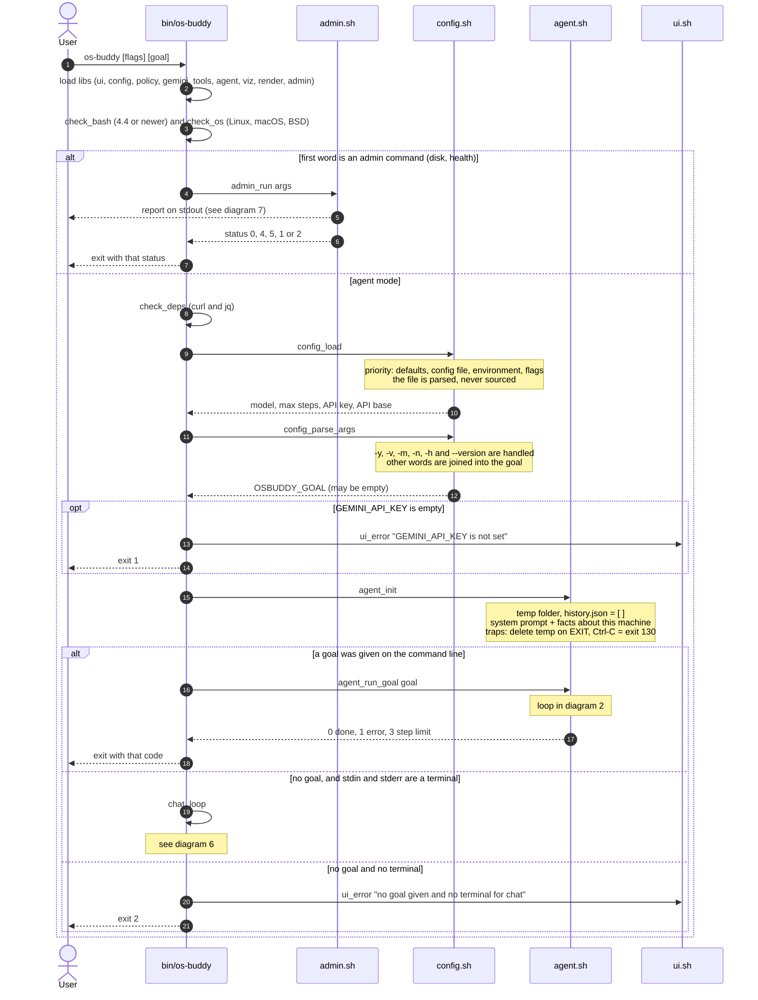
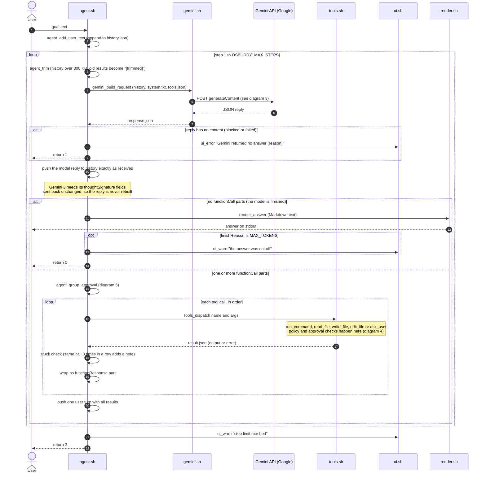
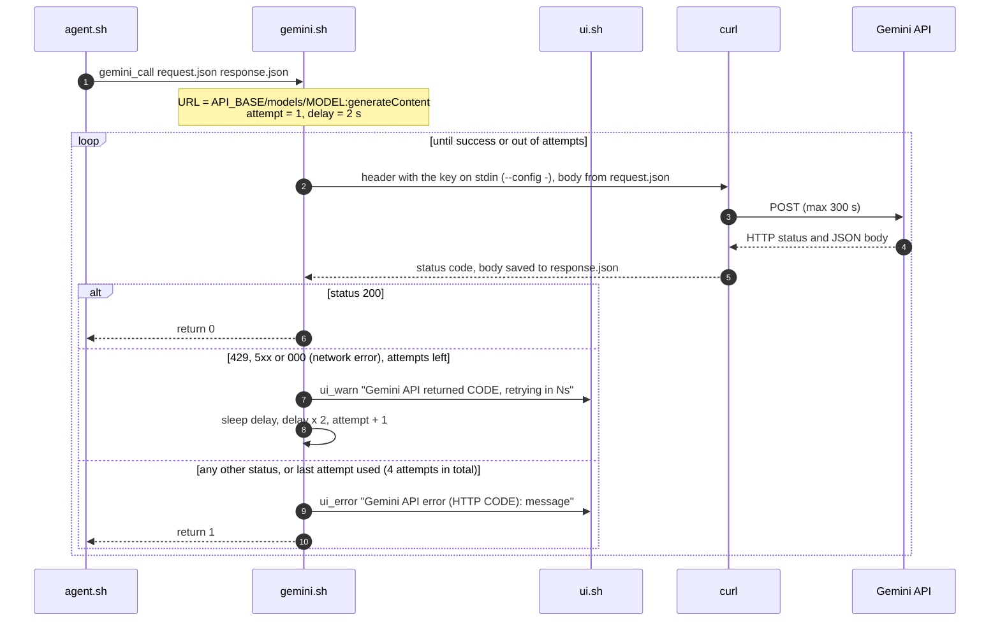
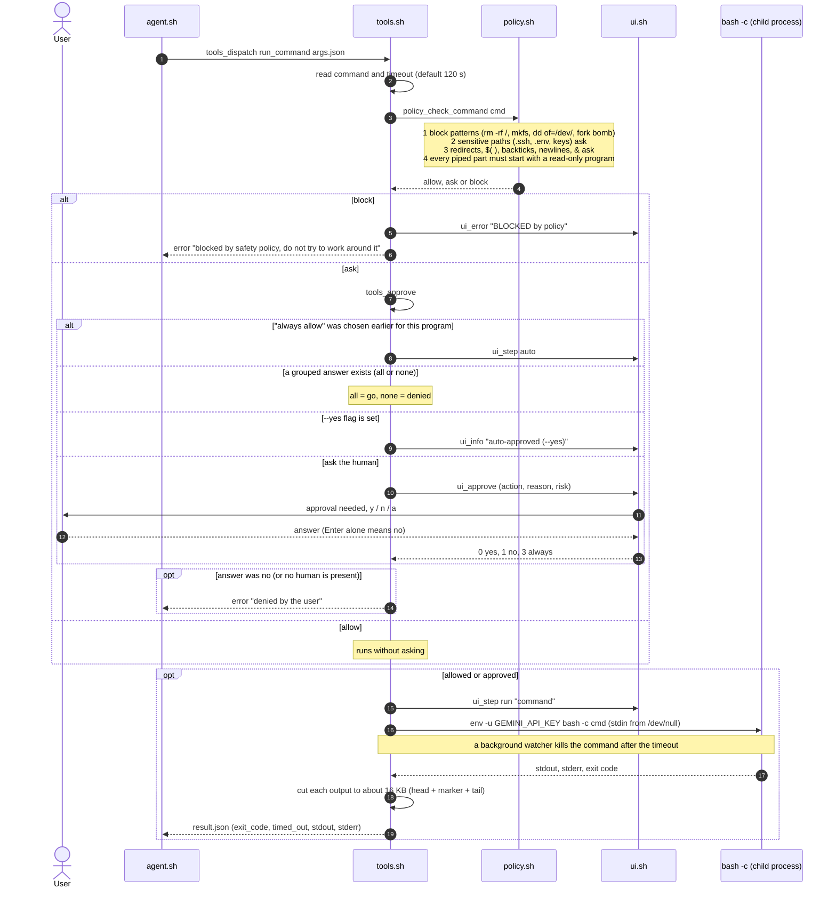
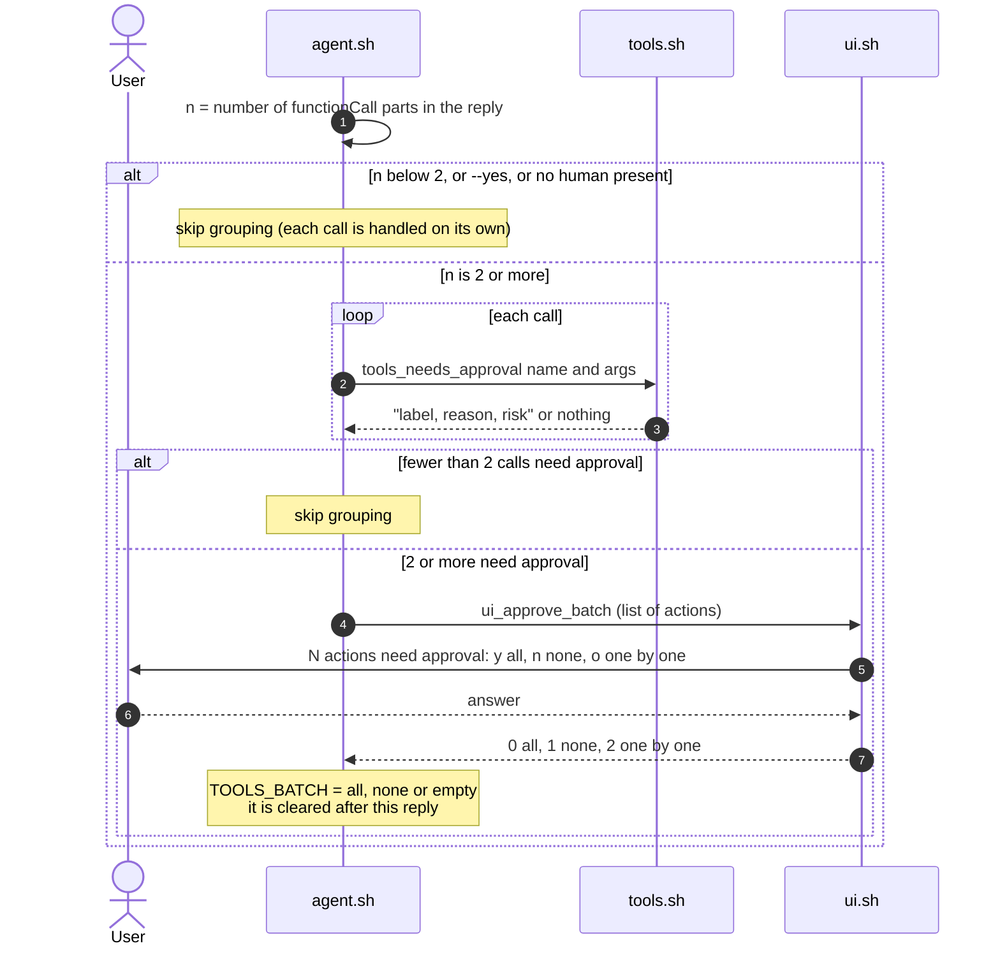
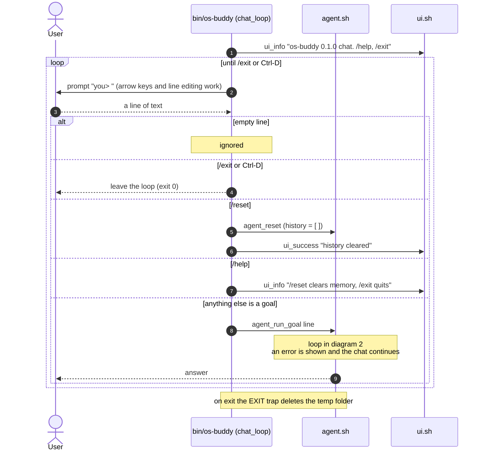
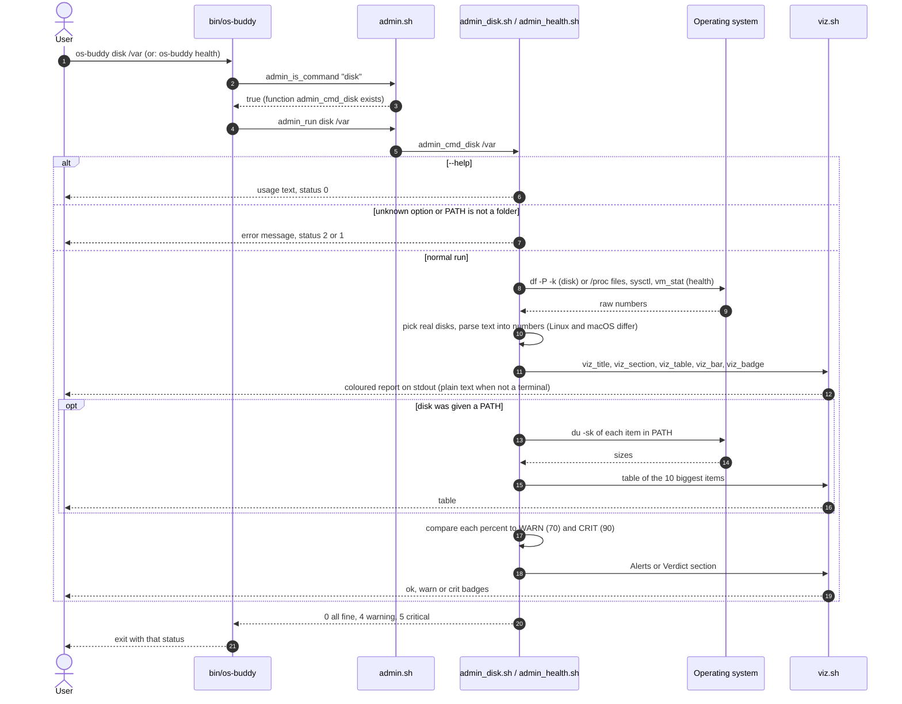

# os-buddy sequence diagrams

These diagrams show **who talks to whom, and in what order**, from the moment the user types `os-buddy` until the program exits.
They match the code in `bin/os-buddy` and `lib/*.sh`.

Related docs: [flowchart.md](flowchart.md) (decisions and branches), [use-case-diagram.md](use-case-diagram.md) (who can do what), [design.md](design.md) (PEAS design).

| # | Diagram | Covers |
|---|---|---|
| 1 | [Startup and mode selection](#1-startup-and-mode-selection) | `main()` in `bin/os-buddy` |
| 2 | [One goal, end to end](#2-one-goal-end-to-end-the-agent-loop) | `agent_run_goal` in `lib/agent.sh` |
| 3 | [Calling Gemini with retries](#3-calling-gemini-with-retries) | `gemini_call` in `lib/gemini.sh` |
| 4 | [Running one tool call](#4-running-one-tool-call-with-the-safety-policy) | `tools_dispatch`, `tools_approve`, `policy_check_command` |
| 5 | [Asking one approval for several actions](#5-grouped-approval-two-or-more-actions-in-one-reply) | `agent_group_approval` |
| 6 | [Chat mode](#6-chat-mode) | `chat_loop` |
| 7 | [Admin reports (disk, health)](#7-admin-reports-no-api-key-no-gemini) | `lib/admin*.sh`, `lib/viz.sh` |

Participants used below:

| Name in diagram | File | Role |
|---|---|---|
| Entry | `bin/os-buddy` | Checks the system, loads libraries, picks a mode |
| Config | `lib/config.sh` | Reads the config file, environment and flags |
| Agent | `lib/agent.sh` | The loop: ask the model, run tools, repeat |
| Gemini lib | `lib/gemini.sh` | Builds the request and calls the REST API |
| Tools | `lib/tools.sh` | The actions the model may take |
| Policy | `lib/policy.sh` | Classifies an action as allow, ask or block |
| UI | `lib/ui.sh` | Messages and prompts for the human (all on stderr) |
| Render | `lib/render.sh` | Turns the model's Markdown into terminal text |

---

## 1. Startup and mode selection

What happens before any AI call. Admin commands leave early because they need no API key.

---

## 2. One goal, end to end (the agent loop)

The heart of os-buddy. Each pass of the loop is one **step**. The loop stops when Gemini answers without asking for a tool, when an error happens, or after `OSBUDDY_MAX_STEPS` (default 30).

---

## 3. Calling Gemini with retries

`gemini_call` keeps the API key out of `ps` output by sending it on `curl`'s stdin. It retries rate limits, server errors and network errors with exponential backoff.

---

## 4. Running one tool call with the safety policy

Every tool call goes through the policy first. The model cannot skip this step, and a **block** decision cannot be overridden, not even with `--yes`.

This diagram uses `run_command`. `read_file` is checked the same way (only private paths ask). `write_file` and `edit_file` always ask.

---

## 5. Grouped approval (two or more actions in one reply)

When Gemini asks for several risky actions at once, os-buddy shows them together and asks **one** question instead of many. Blocked actions are not part of the question and stay blocked.

---

## 6. Chat mode

Started when no goal is given and a human is at the terminal. The history is kept between turns, so the model remembers earlier goals until `/reset`.

---

## 7. Admin reports (no API key, no Gemini)

`os-buddy disk [PATH]` and `os-buddy health` run fixed, read-only checks. The dispatcher finds a command by the function name `admin_cmd_<word>`, so a new command needs no change in the entry script.

