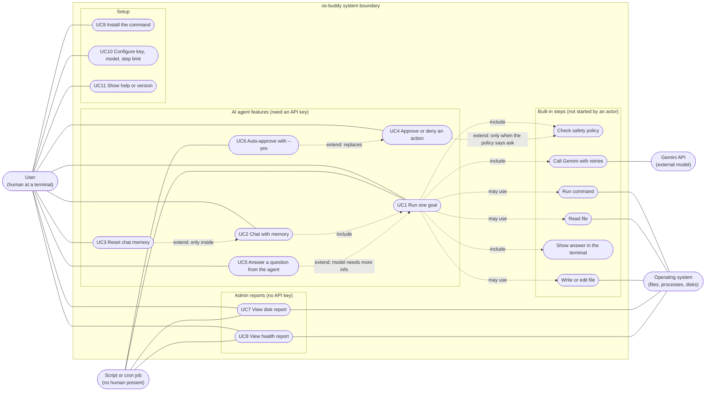
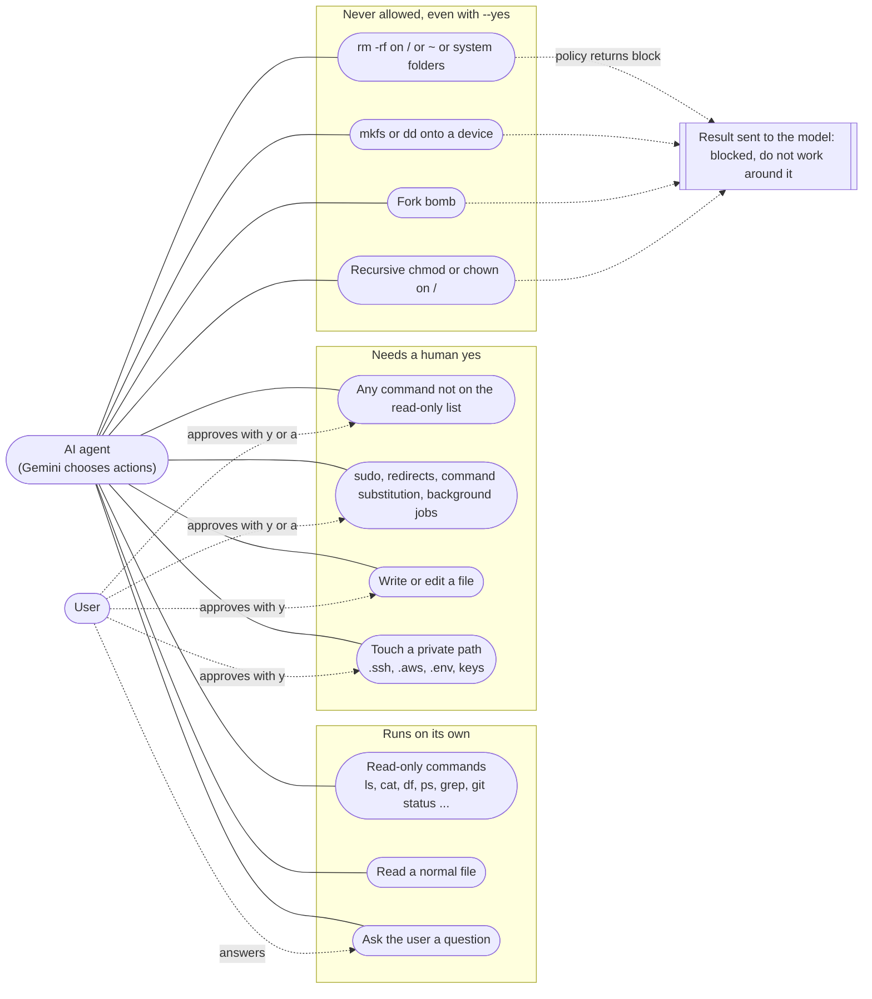

# os-buddy use case diagrams

These diagrams show **who uses os-buddy and what they can do with it**.

Mermaid has no dedicated UML use case diagram, so these are drawn as flowcharts in the usual use case style:
actors outside, a box for the system boundary, ovals for use cases, and dotted arrows for `include` and `extend`.

Related docs: [sequence-diagram.md](sequence-diagram.md) (order of events), [flowchart.md](flowchart.md) (decisions), [design.md](design.md) (PEAS design).

## Actors

| Actor | Type | Description |
|---|---|---|
| User | Primary, human | Sits at a terminal. Gives goals, approves or denies changes, answers questions. |
| Script or cron job | Primary, automated | Runs `os-buddy "goal"` or an admin report with no human present. Reads stdout and the exit code. |
| Gemini API | Secondary, external system | Google's model. Plans the work and chooses which tool to call. Never touches the machine directly. |
| Operating system | Secondary, the target | Files, processes, disks and memory. The only thing os-buddy changes or inspects. |

## 1. System overview

How to read the arrows:

- A plain line joins an actor to a use case it can start, or a use case to the external system it talks to.
- `include`: the use case always does this step.
- `extend`: the step happens only under a condition (for example, approval is only asked when the policy says **ask**).

## 2. Use case descriptions

### UC1 Run one goal

| | |
|---|---|
| Command | `os-buddy "find the 3 largest files here"` |
| Actors | User or Script (primary), Gemini API and Operating system (secondary) |
| Precondition | `GEMINI_API_KEY` is set. Bash 4.4+, `curl` and `jq` are installed. |
| Main flow | 1. The goal is added to the history. 2. Gemini replies with text or tool calls. 3. Each tool call is checked by the policy, approved if needed, and run. 4. Results go back to Gemini. 5. Steps 2 to 4 repeat until Gemini answers without a tool call. 6. The answer is shown. |
| Alternative flows | Policy blocks an action: the model is told and must choose another way. User denies: same. Gemini returns nothing: error, exit 1. API fails: retry, then error. Same call 3 times in a row: the model gets a nudge. |
| Postcondition | Exit code 0 done, 1 error, 3 step limit reached. |

### UC2 Chat with memory

| | |
|---|---|
| Command | `os-buddy` (needs a terminal) |
| Actors | User |
| Main flow | The user types goals at the `you>` prompt. Each goal runs UC1, and the history carries over, so follow-up questions work. `/help` and `/exit` are available. Ctrl-D also ends the chat. |
| Alternative flow | No terminal and no goal: error and exit 2. |

### UC3 Reset chat memory

| | |
|---|---|
| Command | `/reset` inside a chat |
| Actors | User |
| Result | The history is emptied. Session "always allow" choices are kept until the chat ends. |

### UC4 Approve or deny an action

| | |
|---|---|
| When | The policy says **ask**: anything that is not clearly read-only, every `write_file` and `edit_file`, and any private path (`.ssh`, `.env`, keys). |
| Actors | User |
| Choices | `y` yes, `n` or Enter no, `a` always allow this program for the rest of the chat (not offered for `sudo`, `rm`, `dd`, `kill`, shells, chained commands, and similar). |
| Group prompt | If one reply holds 2 or more risky actions, they are shown together: `y` all, `n` none, `o` one by one. |
| No human | The answer is no, and the model is told "denied by the user". |

### UC5 Answer a question from the agent

| | |
|---|---|
| Trigger | The model calls the `ask_user` tool because it needs a choice or missing information. |
| Actors | User |
| Alternative flow | No human present: the tool returns an error and the model must decide alone or stop. |

### UC6 Auto-approve with --yes

| | |
|---|---|
| Command | `os-buddy -y "goal"` |
| Actors | Script or User |
| Result | Every **ask** is approved without a prompt. **Block** is never overridden. Meant for trusted automation only. |

### UC7 View disk report

| | |
|---|---|
| Command | `os-buddy disk [PATH]` |
| Actors | User or Script |
| Result | A table of real disks with a usage bar and status, an alerts section, and with `PATH` the 10 biggest items inside it. |
| Exit code | 0 fine, 4 a disk is above 70 percent, 5 a disk is above 90 percent, 1 error, 2 bad option. |
| Notes | No API key and no network. |

### UC8 View health report

| | |
|---|---|
| Command | `os-buddy health` |
| Actors | User or Script |
| Result | Host facts, a table of CPU, load, memory, swap and the fullest disk, then one verdict line. |
| Exit code | 0 healthy, 4 warning, 5 critical, 1 error, 2 bad argument. |
| Notes | Works on Linux (`/proc`) and macOS (`sysctl`, `vm_stat`). No API key. |

### UC9 Install the command

| | |
|---|---|
| Command | `./install.sh` |
| Result | Links `bin/os-buddy` into `~/.local/bin`, creates `~/.config/os-buddy/config` (mode 600) from the example, and warns if `~/.local/bin` is not on `PATH`. Safe to run again. |

### UC10 Configure key, model and step limit

| | |
|---|---|
| Where | Config file, environment variables, or flags `-m` and `-n`. |
| Priority | defaults, then config file, then environment, then flags (the last one wins). |
| Config file | `.env` in the project folder, otherwise `~/.config/os-buddy/config`. Only `GEMINI_API_KEY`, `OSBUDDY_MODEL` and `OSBUDDY_MAX_STEPS` are read. The file is parsed, never run. A warning is shown unless it is mode 600. |

### UC11 Show help or version

| | |
|---|---|
| Commands | `os-buddy --help`, `os-buddy --version` |
| Result | Usage text or version, exit 0. |

## 3. Who is allowed to do what (permission view)

This second diagram shows the **safety rules** as use cases: what the agent may do alone, what needs a human, and what nobody can do.

Two protections apply to everything the agent runs:

- `GEMINI_API_KEY` is removed from the environment of every command (`env -u GEMINI_API_KEY`), and it is given to `curl` on stdin so it never shows in `ps`.
- Command output is cut to about 16 KB before it goes back to the model, and old results are trimmed when the history passes 300 KB.
